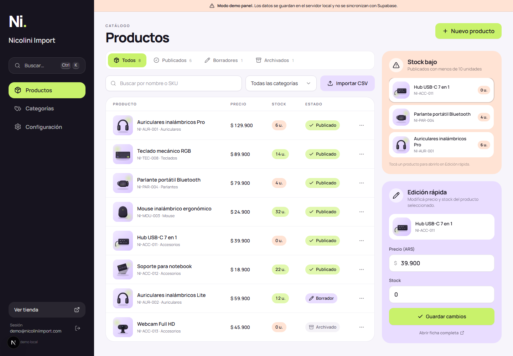
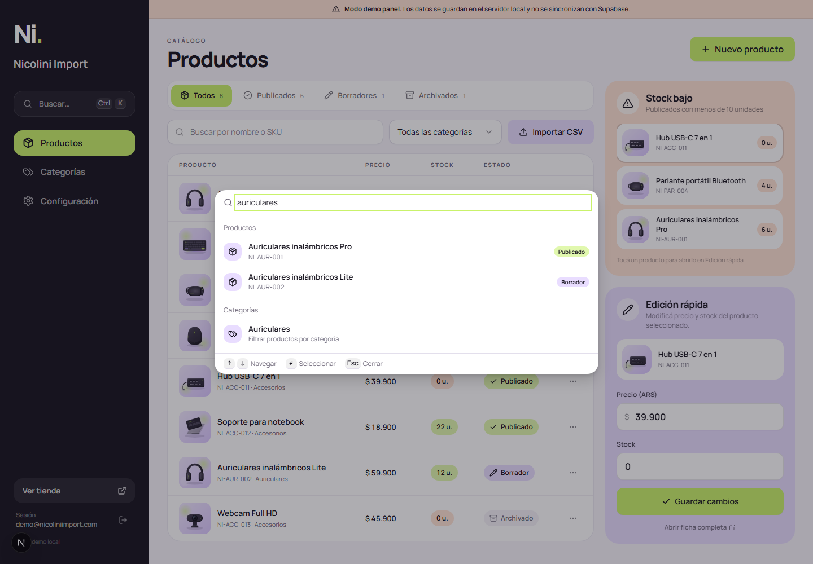
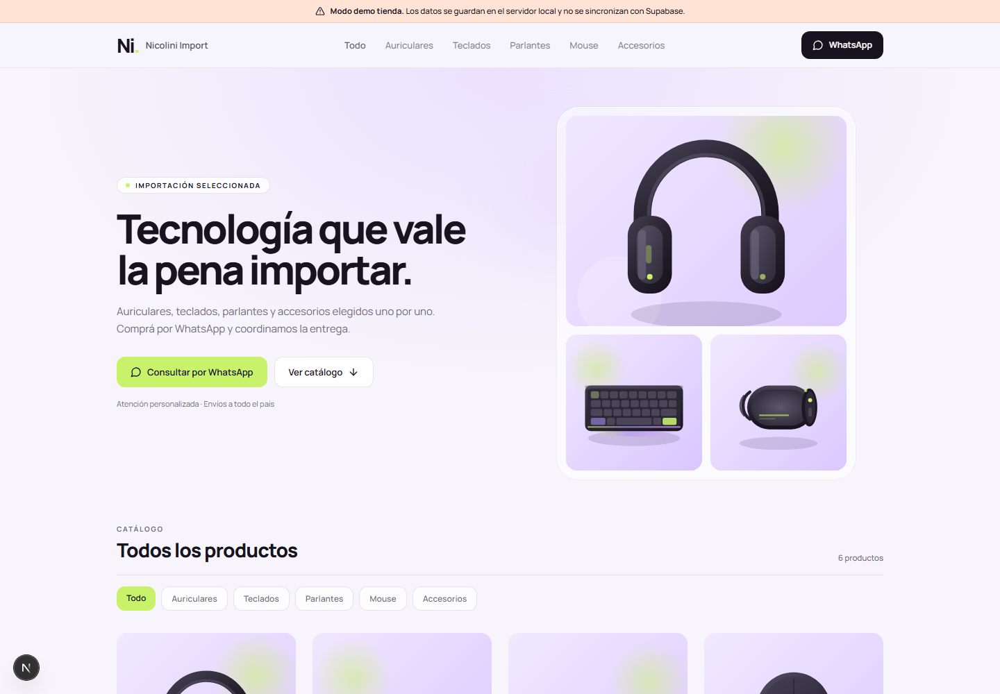
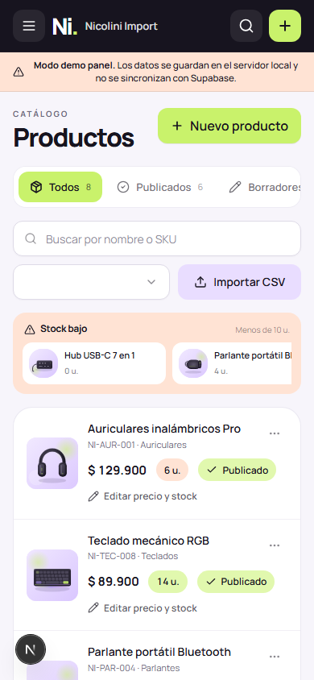
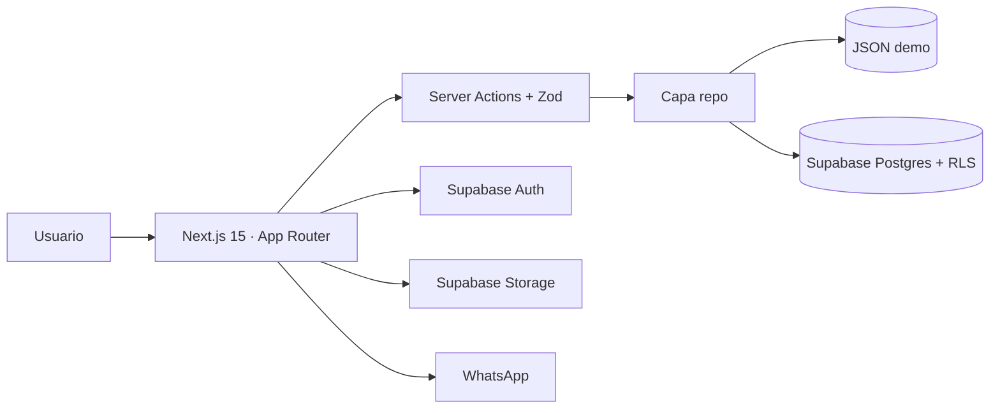

# Nicolini Import · E-commerce con panel de administración

Aplicación full-stack de catálogo, venta por WhatsApp y backoffice para una tienda de tecnología. Next.js 15, React 19, TypeScript, Supabase y una integración selectiva de Astryx.

> **English summary:** A full-stack e-commerce starter with a public catalog, WhatsApp checkout and an admin backoffice. Built with Next.js 15, React 19, TypeScript, Supabase and a selective Astryx integration.

[](https://github.com/luchonicolini/Panel_demo/actions/workflows/ci.yml)


[](LICENSE)

> **Demo local reproducible.** No necesitás Supabase, Docker ni credenciales externas: la app arranca con datos ficticios y un login de demostración.

| Panel de productos | Command palette |
| --- | --- |
|  |  |

| Tienda pública | Panel en mobile |
| --- | --- |
|  |  |

## Demo rápida

Requisitos: **Node.js 22.13 o superior** y npm 10+.

```bash
git clone https://github.com/luchonicolini/Panel_demo.git
cd Panel_demo
npm install
npm run dev
```

Abrí `http://localhost:3000`.

| Acceso | URL | Credenciales |
| --- | --- | --- |
| Tienda | `/` | — |
| Panel | `/admin/productos` | `demo@nicoliniimport.com` / `demo1234` |

En modo demo los datos se guardan en `.data/demo-db.json`, las imágenes en `public/uploads/` y la sesión se firma con `DEMO_AUTH_SECRET`. La tienda y el panel muestran un aviso visible de “Modo demo”.

## Qué demuestra este proyecto

- **Producto:** catálogo público, consulta por WhatsApp, panel de administración, importación CSV, stock bajo y configuración de marca sin tocar código.
- **Full-stack:** Server Actions, validación con Zod, autenticación con Supabase, RLS y una capa de repositorio con dos implementaciones (demo y Supabase).
- **UX:** command palette con búsqueda server-side, atajos de teclado, skeletons, tooltips, edición rápida y diseño responsive.
- **Criterio técnico:** modo demo seguro, separación de secretos, errores de configuración explícitos y una integración de Astryx sin reescribir la UI existente.
- **Calidad:** tests unitarios con Vitest, E2E con Playwright en desktop y mobile, lint, typecheck y CI en GitHub Actions.

## Stack

| Capa | Tecnología |
| --- | --- |
| Frontend | Next.js 15 (App Router), React 19, TypeScript, Tailwind CSS, Radix UI / shadcn/ui |
| Detalles de UI | Astryx 0.7: command palette, `Kbd`, `Tooltip`, `Skeleton` |
| Backend | Server Actions, Zod, Supabase Postgres, Auth y Storage con RLS |
| Datos | Supabase en producción; adaptador JSON local para la demo |
| Testing | Vitest, Playwright, GitHub Actions |
| Deploy sugerido | Vercel + Supabase |

## Arquitectura



La UI no habla directo con la base: las mutaciones pasan por Server Actions, que validan sesión, permisos y datos antes de llamar a la capa de repositorio. Esa capa tiene una implementación demo y una de Supabase, con la misma interfaz.

### Decisiones técnicas

- **Server Actions + `revalidatePath`:** menos endpoints manuales, menos estado duplicado y mutaciones consistentes con el App Router.
- **Autorización en el servidor:** cada acción de escritura vuelve a verificar la sesión y el rol de admin. Ocultar un botón no es una medida de seguridad.
- **Dos adaptadores de datos:** el modo demo permite mostrar el producto sin infraestructura; Supabase cubre el caso real. La interfaz compartida evita divergencias.
- **Modo demo con guardas:** en producción no se activa implícitamente. Si falta configuración, el servidor falla con un mensaje claro en lugar de arrancar con datos locales.
- **Astryx selectivo:** se incorporó donde aporta valor (palette, atajos, tooltips, skeletons) sin migrar la identidad visual existente.
- **Búsqueda server-side:** la command palette consulta con la sesión del admin, no expone datos desde el cliente y navega con teclado o mouse.

## Pasar a Supabase

### 1. Crear el proyecto

1. Creá un proyecto en [supabase.com](https://supabase.com).
2. En **SQL Editor**, ejecutá completo `supabase/migrations/20261119000000_init.sql`.
3. Opcional: ejecutá `supabase/seed.sql` para cargar categorías y productos de ejemplo.

La migración crea:

- Tablas `categories`, `products`, `product_images`, `site_settings` y `admin_users`.
- Enums, triggers de `updated_at`, índices de búsqueda y funciones de autorización.
- Políticas RLS: el público solo lee productos publicados; escribir requiere ser admin.
- Bucket público `product-images` con límite de 5 MB y políticas de Storage.

### 2. Variables de entorno

Copiá `.env.example` a `.env.local` y completá:

```env
NEXT_PUBLIC_SUPABASE_URL=https://tu-proyecto.supabase.co
NEXT_PUBLIC_SUPABASE_ANON_KEY=tu_anon_key
SUPABASE_SERVICE_ROLE_KEY=tu_service_role_key   # solo para el script de bootstrap
NEXT_PUBLIC_SITE_URL=http://localhost:3000
```

> `SUPABASE_SERVICE_ROLE_KEY` nunca debe llevar el prefijo `NEXT_PUBLIC_` ni llegar al navegador. Solo la usa `scripts/bootstrap-admin.mjs` en el servidor.

Si `DEMO_MODE=true`, la app ignora Supabase aunque haya credenciales. Dejalo en `false` o eliminá la variable en producción.

### 3. Crear el primer administrador

El panel exige un usuario de Supabase Auth **y** una fila en `admin_users`. El script hace las dos cosas (crea o reutiliza el usuario, confirma el email y deja la contraseña indicada):

```bash
npm run seed:admin -- --email admin@tutienda.com --password "una-clave-segura"
```

También podés usar variables de entorno:

```bash
ADMIN_EMAIL=admin@tutienda.com ADMIN_PASSWORD="una-clave-segura" npm run seed:admin
```

Luego ingresá en `/login` con ese email y contraseña.

### 4. Ejecutar

```bash
npm run dev      # desarrollo
npm run build    # build de producción
npm run start    # servir el build
npm run typecheck
```

En Vercel (o el hosting elegido) configurá las variables públicas y `NEXT_PUBLIC_SITE_URL` con el dominio final. No hace falta `SUPABASE_SERVICE_ROLE_KEY` en runtime: solo se usa localmente para el bootstrap.

Si el servidor de producción arranca sin Supabase y sin `DEMO_MODE=true`, falla a propósito con un mensaje que indica qué variable falta. También devuelve `503` en `/admin` y `/login` si la configuración es inválida.

> **Estado de la integración:** el flujo con Supabase está implementado y tipado, pero la suite E2E de este repositorio corre en modo demo. Antes de un despliegue real, probá la migración, RLS y Storage en un proyecto propio.

### Modo demo en producción

En producción **no se activa solo**: si faltan las variables de Supabase y `DEMO_MODE` no es `true`, el servidor no arranca y muestra un error de configuración. Esto evita desplegar por accidente una tienda con datos locales y credenciales conocidas.

Si querés publicar una demo explícita, configurá:

```env
DEMO_MODE=true
DEMO_ADMIN_EMAIL=tu-email@demo.com
DEMO_ADMIN_PASSWORD=una-clave-propia-de-8-o-mas
DEMO_AUTH_SECRET=un-secreto-aleatorio-de-32-o-mas-caracteres
```

El arranque se rechaza si `DEMO_AUTH_SECRET` es el valor por defecto o mide menos de 32 caracteres, o si la contraseña es `demo1234`. La demo pública sigue siendo solo para mostrar: no la uses como entorno real.

### Reiniciar los datos demo

Con el servidor detenido, borrá el archivo de base y, si querés, las fotos subidas:

```bash
# PowerShell
Remove-Item .data/demo-db.json
Remove-Item public/uploads/* -Recurse -Force -ErrorAction SilentlyContinue
```

Al volver a entrar, se regenera el seed automáticamente.

### Cambiar credenciales demo

Creá `.env.local`:

```env
DEMO_ADMIN_EMAIL=admin@demo.com
DEMO_ADMIN_PASSWORD=una-clave-larga
DEMO_AUTH_SECRET=un-secreto-propio
```

## Clonar para otro cliente

Checklist corto:

1. **Marca:** editá `src/config/brand.ts` (nombre, tagline, monograma, color, WhatsApp, email, Instagram, footer). Es la fuente de verdad inicial y el fallback si la base todavía no tiene configuración.
2. **Logo e imágenes:** reemplazá los archivos de `public/brand` (si usás logo) y `public/products`. Los productos del seed apuntan a `/public/products`.
3. **Supabase:** creá un proyecto nuevo y corré la migración + seed.
4. **Entorno:** nuevo `.env.local` con las claves del cliente.
5. **Admin:** corré `npm run seed:admin` con el email del cliente.
6. **Configuración en runtime:** desde `/admin/configuracion` el dueño puede cambiar nombre, logo, color de marca, WhatsApp y umbral de stock sin tocar código. Esos valores se guardan en `site_settings` y pisan los defaults.
7. **Deploy:** publicá el repo y configurá las variables en el hosting.

Los textos de la tienda y del panel están en español (ARS, `es-AR`). Si necesitás otro idioma/moneda, los puntos principales son `src/config/brand.ts`, `src/lib/format.ts` y los componentes de `src/components`.

## Qué incluye el panel

Ruta base: `/admin` → redirige a `/admin/productos`.

- **Productos:** listado con foto, nombre, SKU, categoría, precio en ARS, stock y estado. Búsqueda por nombre/SKU, filtros por categoría y estado.
- **Estados:** Borrador, Publicado y Archivado. Crear, editar, duplicar como borrador, archivar y restaurar.
- **Formulario completo:** nombre, SKU, categoría, descripción, precio, stock, estado y hasta 6 fotos con vista previa y opción de quitar.
- **Edición rápida:** precio y stock desde el panel lateral en desktop o bottom sheet en mobile, con contexto del producto y confirmación de éxito/error.
- **Stock bajo:** solo productos publicados con stock por debajo del umbral configurable o en cero. Usa la misma fuente de datos que el listado y abre la edición rápida.
- **Categorías:** crear, renombrar y reordenar. Para eliminar una categoría primero hay que reasignar sus productos.
- **Importación CSV:** plantilla descargable, vista previa fila por fila, errores, conteo de altas/actualizaciones antes de aplicar. El SKU identifica productos existentes; los SKU duplicados dentro del archivo se rechazan.
- **Configuración:** nombre de tienda, logo, color de marca, WhatsApp y umbral de stock.
- **Command palette:** `Ctrl/Cmd+K` o el botón **Buscar** abre un buscador global con acciones del panel, productos y categorías. La búsqueda se resuelve en el servidor con sesión de admin y navega con teclado o mouse.
- **Detalles de interacción:** atajos con `Kbd`, tooltip en el acceso mobile y skeletons de carga para el listado y la ficha de producto.
- **Tienda pública:** solo muestra productos publicados, indica “Agotado” con stock 0 y permite consultar por WhatsApp con el nombre del producto en el mensaje.

### Formato del CSV

Columnas obligatorias: `nombre`, `sku`, `categoria`, `precio`, `stock`. Opcionales: `descripcion`, `estado`.

```csv
nombre,sku,categoria,descripcion,precio,stock,estado
Auriculares inalámbricos Pro,NI-AUR-001,Auriculares,Auriculares over-ear con cancelación de ruido.,129900,6,publicado
Teclado mecánico RGB,NI-TEC-008,Teclados,Teclado mecánico con switches táctiles.,89900,14,borrador
```

- La categoría debe existir previamente (se compara sin distinguir mayúsculas ni acentos).
- `estado` acepta `borrador`, `publicado` o `archivado` (vacío = borrador).
- El precio acepta formatos como `129900` o `129.900,00`.
- Si una sola fila tiene errores, la importación **no aplica ningún cambio**. El servidor vuelve a validar el archivo al confirmar.

## Seguridad

- `/admin` está protegido en el servidor: sin sesión redirige a `/login`.
- Cada Server Action de escritura vuelve a verificar la sesión y el rol de admin; no alcanza con ocultar botones en el cliente.
- RLS en todas las tablas: el público solo lee datos publicados y la configuración pública; las escrituras requieren `public.is_admin()`.
- Storage con lectura pública de fotos y escritura/borrado solo para admins.
- Validación Zod en el servidor para productos, categorías, configuración y CSV.
- La `service_role` solo se usa en el script de bootstrap, nunca en componentes cliente.
- El modo demo no se activa implícitamente en producción y exige secretos propios.
- La configuración se valida al arrancar el servidor mediante `src/instrumentation.ts`.

Para reportar una vulnerabilidad, seguí [SECURITY.md](SECURITY.md). No abras un issue público con detalles explotables.

## Estructura

```text
src/
  app/
    (store)/            tienda pública: catálogo, producto, layout
    admin/              panel: productos, categorías, configuración
    api/import/template plantilla CSV
    login/              acceso
  components/           UI de tienda, panel y primitivas
    admin/command-menu.tsx      provider y trigger de la command palette
    admin/command-palette.tsx   palette Astryx y búsqueda global
  config/brand.ts       marca centralizada para clonar
  lib/
    actions/            Server Actions (auth, productos, categorías, settings, import, command)
    demo/               seed y persistencia JSON del modo demo
    repo/               acceso a datos: demo y Supabase
    supabase/           clientes server/admin/middleware
    csv.ts              parser y validación de importación
    instrumentation.ts  validación de entorno al arrancar
e2e/                    tests Playwright (desktop + mobile)
src/**/*.test.ts        tests unitarios con Vitest
.github/workflows/      CI: typecheck, lint, unitarios, build y E2E
supabase/
  migrations/           esquema, RLS y Storage
  seed.sql              datos de ejemplo
scripts/
  bootstrap-admin.mjs   primer administrador en Supabase
```

## Astryx

La integración es **selectiva**: no se reemplazaron los componentes Tailwind/Radix existentes.

- `@astryxdesign/core` + `@astryxdesign/theme-neutral` aportan la command palette, `Kbd`, `Tooltip` y `Skeleton`.
- El tema neutral se ajusta con tokens de Nicolini (lima, lilac y Manrope) en `src/app/globals.css`.
- Tailwind Preflight está desactivado y Astryx aporta el reset global. Las capas CSS se declaran en `globals.css` para que las utilidades de Tailwind sigan teniendo prioridad.
- La búsqueda de la palette usa `src/lib/actions/command.ts`, que vuelve a verificar la sesión de admin en el servidor.
- Para trabajar con Astryx: `npx @astryxdesign/cli component <Nombre>` o `npx @astryxdesign/cli search "<tema>"`. El CLI queda como `devDependency`.

## Calidad y CI

```bash
npm run lint
npm run typecheck
npm test                 # unitarios (Vitest)
npm run build
npm run test:e2e         # build + Playwright (desktop y mobile)
npm run test:e2e:ui      # modo interactivo
```

La primera vez hay que instalar el navegador de Playwright:

```bash
npx playwright install chromium
```

Los E2E corren contra un build de producción en el puerto `3100`, con modo demo explícito y datos aislados en `.data/e2e` y `public/uploads/e2e`. No tocan tu base demo local. El flujo cubre:

- Login, creación con foto, borrador, publicación y visibilidad en la tienda.
- Edición rápida de precio/stock y reflejo en la tienda.
- CSV inválido rechazado sin modificar datos.
- Archivo del producto y desaparición del catálogo.
- Command palette: atajo `Ctrl/Cmd+K`, búsqueda y navegación a un producto.
- Mobile: bottom sheet, formulario, command palette y catálogo sin scroll horizontal.

El workflow [`.github/workflows/ci.yml`](.github/workflows/ci.yml) ejecuta lint, typecheck, tests unitarios, build y E2E en cada push a `main` y en pull requests.

## Alcance

**Incluido:** catálogo, panel de productos, categorías, configuración, importación CSV, stock bajo, edición rápida y venta por WhatsApp.

**Fuera de alcance por ahora:** sección de inventario separada, carrito, checkout, pedidos y pagos online. La compra se coordina por WhatsApp, como en la referencia.

## Contribuir

Las contribuciones son bienvenidas. Antes de abrir un PR, revisá [CONTRIBUTING.md](CONTRIBUTING.md) y ejecutá los checks locales. Para vulnerabilidades, usá el canal privado de [SECURITY.md](SECURITY.md).

## Historial de cambios

Ver [CHANGELOG.md](CHANGELOG.md) para el detalle de la versión inicial y próximas iteraciones.

## Autor

**Luciano Nicolini** — [GitHub](https://github.com/luchonicolini)

Si te interesa el proyecto o querés discutir una implementación similar, podés abrir un issue o contactarme por GitHub.

## Licencia

[MIT](LICENSE) © 2026 Luciano Nicolini
